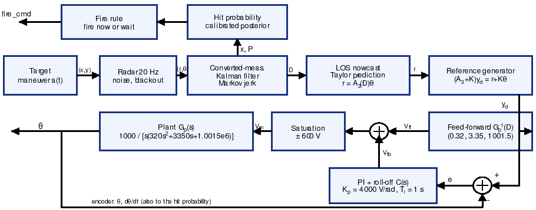
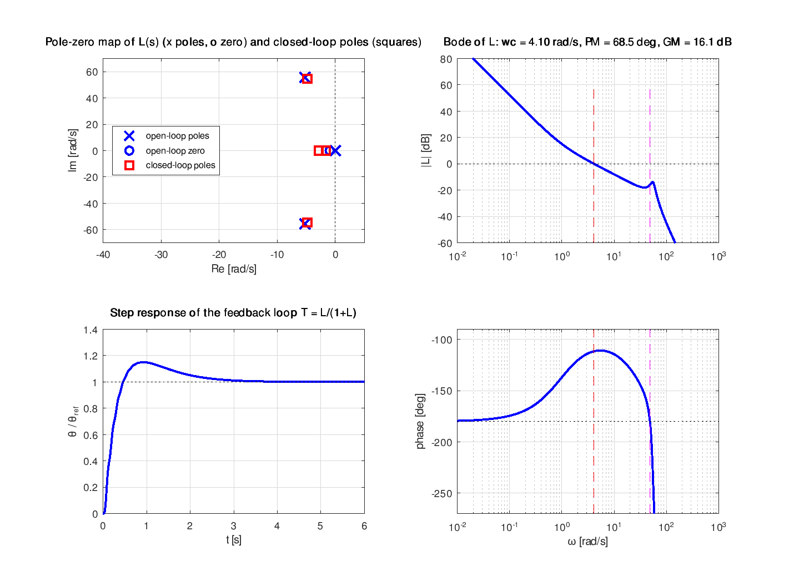
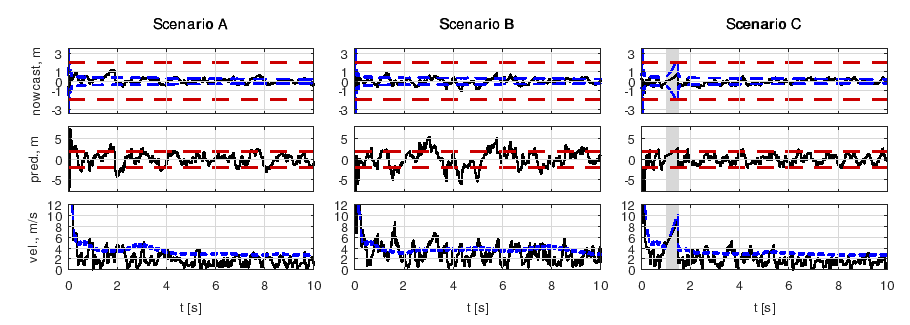
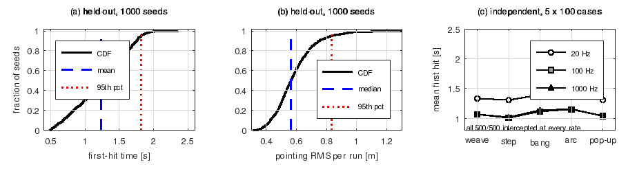

<div align="center">

# PREDICTIVE TRACKING & TURRET CONTROL

### For a Maneuvering Aerial Target

**ME 319 · Control Systems · IIT Bombay · Autumn 2026**

A model-based, estimation-led control system built from first principles in **GNU Octave** — combining target-state estimation, present-bearing prediction, exact plant-inverse feed-forward, PI feedback, and probabilistic fire control.

[](https://octave.org/)
[](https://www.octave.org/)
[](#verification)
[](#held-out-evaluation)
[](#)

[**Architecture**](#system-architecture) · [**Results**](#results-at-a-glance) · [**Run it**](#quick-start) · [**Repository map**](#repository-map) · [**Engineering notes**](#engineering-notes)

</div>

---

## The problem

A turret must track and intercept a maneuvering aerial target using only noisy radar measurements arriving at **20 Hz**. The target can maneuver, the radar can go silent for up to **0.5 s**, and the elevation drive is a lightly damped electromechanical plant with finite voltage and mechanical travel.

The controller must do more than follow a measured angle:

- Estimate the target's motion from noisy range–bearing observations.
- Predict its motion through the measurement delay and radar blackouts.
- Move a constrained turret without exciting its lightly damped dynamics.
- Decide **when** to issue a pulse, accounting for uncertainty and the one-second recharge interval.
- Remain reliable across maneuver profiles, call rates, measurement conventions, and plant variations.

This repository contains the complete GNU Octave implementation, analytical control studies, simulation harness, verification suite, evaluation outputs, plots, and IEEE-style technical report.

> **Scope:** This is an academic, software-only simulation and control-design project. The turret, target, radar, laser beam, and firing events are modeled in software; the repository does not implement or operate physical weapon hardware.

## Results at a glance

The figures below are from the committed evaluation artifacts, not hand-picked single-run demonstrations.

| Evaluation | Reported result |
|---|---:|
| Frozen design, held-out random engagements | **1,000 / 1,000 intercepted** |
| Held-out Wilson 95% upper bound on failure probability | **< 0.383%** |
| Mean first-interception time | **1.236 s** |
| 95th-percentile first-interception time | **1.820 s** |
| Median pointing RMS across held-out runs | **0.564 m** |
| 95th-percentile pointing RMS | **0.834 m** |
| Time spent inside the 2 m engagement radius | **99.43%** |
| Independent campaign | **500 / 500 intercepted per call-rate configuration** |
| Full local verification suite | **25 / 25 checks passed** |

<sub>Held-out campaign: seeds MC5000–MC5999, frozen design, 100 Hz controller calls, initial turret angle 0°. Independent campaign: five separately implemented trajectory families, 100 cases per family, at 20/100/1000 Hz. Both generators and campaign runners are project-authored; the independent campaign is an independent implementation within this project, not an external validation.</sub>

### Held-out campaign

| Metric | Result |
|---|---:|
| Interceptions | 1000 / 1000 |
| Wilson 95% interval for success | [0.9962, 1.0000] |
| First-hit time — mean / median | 1.236 / 1.240 s |
| First-hit time — p95 / maximum | 1.820 / 2.350 s |
| Pointing RMS — median / p95 | 0.564 / 0.834 m |
| Pulses on target | 9,198 / 9,204 |
| Worst pulse miss distance | 3.354 m |

The 1,000/1,000 result corresponds to a **Wilson lower confidence limit** of 0.9962; the reported one-sided failure bound is therefore below 0.383% under this simulation protocol. It is an empirical result for the specified held-out seed family, not a guarantee for arbitrary targets or real hardware.

### Standard scenarios

At 100 Hz, with the turret starting at 0°:

| Scenario | Description | First hit | Pulses hit | Pointing RMS |
|---|---|---:|---:|---:|
| A | Constant-velocity target | 0.94 s | 9 / 9 | 0.402 m |
| B | Smooth bounded manoeuvres | 0.94 s | 9 / 9 | 0.513 m |
| C | Scenario A with a 0.5 s radar blackout | 0.94 s | 9 / 9 | 0.375 m |

### Controller call-rate check

The separately implemented campaign covers five families — weave, step, bang-bang, arc, and pop-up — with 100 cases per family at each rate.

| Controller rate | Interceptions | Mean first hit |
|---:|---:|---:|
| 20 Hz | 500 / 500 | 1.357 s |
| 100 Hz | 500 / 500 | 1.075 s |
| 1000 Hz | 500 / 500 | 1.083 s |

The complete logs and per-run data are in [`outputs/`](outputs/), with the evaluation protocol documented in [`docs/PROTOCOL.md`](docs/PROTOCOL.md).

---

## System architecture

The design separates **estimating where the target is now**, **generating a smooth reference for the turret**, and **deciding whether a pulse is worth issuing**.

<div align="center">



<sub>Closed-loop architecture — generated from the Octave model.</sub>

</div>

### 1. Target motion and radar measurements

`target_motion_generator.m` provides scripted and seeded target trajectories. Radar observations are generated every 50 ms (20 Hz), with range noise of 1 m and bearing noise of 0.02°. Blackouts return invalid measurements rather than fabricated observations.

The standard scenario set is:

- **A — constant velocity:** straight-line target motion.
- **B — manoeuvring:** smooth, bounded acceleration in both Cartesian axes.
- **C — blackout:** scenario A with a 0.5 s radar outage beginning at 1 s.
- **D1–D6 — stress scenarios:** break-away during data loss, weave, close pass, repeated outages, close-start weave, and aggressive jerk reversals.
- **MC\<seed\> — random admissible trajectories:** reproducible Monte Carlo family.
- **HB\<seed\> — adversarial trajectories:** deliberately difficult manoeuvres and outage timing.
- **Sensor variants:** `+glint`, `+range`, and `+bias` for out-of-spec sensitivity checks.

The scenario definitions and the assumptions used where the assignment leaves initial conditions or manoeuvre shapes unspecified are recorded in [`core/tc_scenario_catalog.m`](core/tc_scenario_catalog.m) and [`docs/ASSUMPTIONS.md`](docs/ASSUMPTIONS.md).

### 2. Converted-measurement Kalman filter

The estimator converts polar radar measurements \((r,\theta)\) into bias-corrected Cartesian observations \((x,y)\), with the corresponding measurement covariance.

Each Cartesian axis is modeled with position, velocity, acceleration, and jerk states:

\[
\mathbf{x}=[p,\ v,\ a,\ j]^\mathsf{T},
\qquad
\dot j=-\frac{1}{\tau_j}j+w.
\]

The filter includes:

- A Gauss–Markov jerk model for manoeuvring-target estimation.
- Closed-form transition and process-noise matrices for arbitrary sample gaps.
- Innovation gating and rejection of repeated or too-close measurements.
- Joseph-form covariance updates.
- NIS-driven adaptive process-noise scaling.
- Speed, acceleration, and jerk envelope projection.
- Covariance growth during blackouts and track recovery after long losses.

The implementation avoids numerically differentiating noisy bearing measurements. Instead, line-of-sight (LOS) derivatives are obtained analytically from the estimated Cartesian state.

**Key modules:** `core/tc_convert_measurement.m`, `core/tc_jerk_model_transition.m`, `core/tc_filter_update.m`, `core/tc_los_derivatives.m`.

### 3. Prediction without aiming at the wrong point

The assignment specifies a prediction horizon of \(t_p=0.5\) s. That does **not** mean the laser should point at the future bearing: the simulated beam is instantaneous, and a pulse must intersect the target's **present** position.

Aiming directly at the future bearing can introduce a large geometric miss. The design therefore uses the third-order Taylor prediction

\[
r=A_3(D)\hat{\theta}, \qquad
A_3(D)=1+t_pD+\frac{(t_pD)^2}{2}+\frac{(t_pD)^3}{6},
\]

as an input to a reference generator rather than as the beam command.

The reference generator is constructed so that

\[
(A_3+K)(D)y_d=r+K(D)\hat{\theta},
\qquad
A_3+K=\frac{t_p^3}{6}(D+p)^3.
\]

Substitution gives

\[
(D+p)^3(y_d-\hat{\theta})=0.
\]

Consequently, the generated reference follows the **current estimated LOS** through a stable triple-pole transient, while providing the derivatives required by the plant inverse. The controller's tracking loop is analytically independent of \(t_p\) under this construction.

### 4. Turret plant and two-degree-of-freedom control

The modeled elevation drive uses armature and mechanical dynamics:

\[
L\dot i=V_m-Ri-NK_e\dot{\theta}_T,
\]

\[
J_{eq}\ddot{\theta}_T=NK_ti-b\dot{\theta}_T.
\]

The nominal transfer function is

\[
G_p(s)=\frac{\theta_T(s)}{V_m(s)}
=\frac{1000}{s(320s^2+3350s+1.0015\times10^6)}.
\]

Its lightly damped electromechanical pole pair is approximately

\[
s=-5.23\pm j55.70\ \text{rad/s},
\qquad
\omega_n=55.9\ \text{rad/s},
\qquad
\zeta=0.094.
\]

The controller combines an exact inverse of the nominal plant with a PI compensator and high-frequency roll-off:

\[
V_m=G_p^{-1}(D)y_d+C(s)(y_d-\theta_T),
\]

\[
C(s)=K_p\frac{T_is+1}{T_is(\tau_fs+1)}.
\]

For the nominal model, the inverse is

\[
G_p^{-1}(D)y_d
=0.32\,y_d^{(3)}+3.35\,y_d^{(2)}+1001.5\,y_d^{(1)}.
\]

The implemented design uses \(K_p=4000\ \text{V/rad}\), \(T_i=1\ \text{s}\), and \(\tau_f=0.03\ \text{s}\). The reported continuous-loop margins are:

| Design quantity | Value |
|---|---:|
| Gain crossover frequency | 4.10 rad/s |
| Phase margin | 68.5° |
| Gain margin | 16.1 dB |
| Peak sensitivity \(M_s\) | 1.21 |
| Closed-loop bandwidth | 5.72 rad/s |

The plant applies a ±600 V voltage clamp. Mechanical travel is limited to −10°…85°. Acquisition-rate and acceleration clamps are derived from the shared parameter set. The 10 A acquisition-current budget is a **design assumption**, not a hard current saturation in the nominal `turret_plant.m` interface.

### 5. Probabilistic fire control

The firing logic does not simply pulse whenever the angular error is small. It evaluates the probability that a pulse issued **now** will land within the 2 m engagement radius.

The posterior hit-probability calculation:

- Conditions the target-position estimate on the acceleration posterior.
- Truncates acceleration hypotheses to the modeled physical envelope.
- Integrates the resulting beam-normal offset distribution using a 25-node tensor Gauss–Hermite rule.
- Tracks both hit probability and the posterior mass of futures whose centre offset lies inside the engagement radius.

The fire rule is an optimal-stopping heuristic:

- **Tracking:** fire immediately above the high-confidence threshold, or arm and wait for a probability peak / timeout.
- **Coasting:** require a sufficiently high, decreasing hit probability before firing during a data outage.
- **After the first pulse:** use a stricter threshold because first-interception time has already been determined.
- Enforce the one-second recharge interval, minimum estimator updates, and a probability-consistency condition.

**Key modules:** `core/tc_hit_probability.m`, `core/tc_firing_rule.m`, `core/tc_beam_miss_distance.m`.

---

## Control-design analysis

The repository is intended to be inspectable as a control-systems project, not just run as a black-box simulation. The `studies/` directory reproduces the analytical reasoning and generates figures and numerical summaries.

| Study | What it investigates |
|---|---|
| Plant response | Transfer-function model, poles, damping, impulse and step response |
| Root locus and Routh | Closed-loop pole movement and gain stability limits |
| Bode and margins | Gain crossover, phase margin, gain margin and sensitivity |
| Compensator comparison | Proportional, lead-compensated and PI + roll-off alternatives |
| Feed-forward vs feedback | Contributions and model-mismatch sensitivity in the linear model |
| LOS linearisation | Range/bearing geometry and cross-range uncertainty |
| Sampling and delay | Radar Nyquist frequency, controller rate, ZOH and delay-induced phase loss |
| Uncertainty margins | ±20% variations in motor and mechanical parameters |
| Design iterations | Measured rationale behind adopted and rejected design changes |
| Ablation and robustness | Paired design comparisons and stress-condition performance |

The analysis is implemented directly in Octave using the project’s polynomial and state-space routines; it does not require MATLAB Control System Toolbox.

### Selected design plots

<div align="center">



<sub>Nominal-loop pole-zero, frequency-response, and step-response analysis.</sub>

<br><br>



<sub>Nowcast and prediction error, including the effect of a radar blackout.</sub>

<br><br>


<sub>Target/turret elevation, beam error, pulse events, and motor voltage.</sub>

<br><br>



<sub>Held-out first-hit and pointing-RMS distributions, plus independent call-rate campaign.</sub>

</div>

---

## Quick start

### Requirements

- **GNU Octave** — developed and re-run locally with Octave 11.3.0.
- **GNU Make** — for the project shortcuts below.
- No MATLAB licence, Simulink, Control System Toolbox, or third-party Octave package is required by the core project.

On macOS, install Octave with Homebrew:

```bash
brew install octave
```

On Ubuntu / Debian:

```bash
sudo apt-get update
sudo apt-get install octave make
```

### 1. Clone the repository

```bash
git clone https://github.com/Charon-68/Turrent-Control-System_ME319.git
cd Turrent-Control-System_ME319
```

The Octave project and its `Makefile` live in the repository root; run every command below from there.

### 2. Run the quick verification and design summary

```bash
make quick
```

This runs the fast analytical checks, the standard A–D6 scenario suite, and the nominal plant/loop design report.

### 3. Run the full test suite

```bash
make test
```

The committed full-suite log records **25/25 checks passed**. The full suite also executes closed-loop interception, call-rate, interface-convention, recovery, repeatability, and plant-mismatch checks; it takes longer than the quick subset.

### 4. Run the standard scenario suite

```bash
make scenarios
```

### 5. Generate report figures

```bash
make report-figures
```

Generated PNG and PDF plots are written to `plots/`. Numerical output and experiment logs are written to `outputs/`.

---

## Make targets

Run all targets from the repository root.

| Command | Purpose |
|---|---|
| `make quick` | Fast checks, scenario suite, design report |
| `make test-quick` | Quick verification subset |
| `make test` | Full verification suite |
| `make scenarios` | Run A–D6 at the default 100 Hz controller rate |
| `make design` | Print nominal plant and loop design metrics |
| `make figures` | Generate design, error-budget, and scenario plots |
| `make report-figures` | Generate the six report figures |
| `make heldout` | Run held-out campaign chunk MC5000–5299 |
| `make heldout-merge` | Merge the three held-out chunks into `outputs/heldout_final` |
| `make independent` | Run the independent-generator campaign (five families) and write its report |
| `make calibration` | Hit-probability calibration study |
| `make ablation` | Paired ablation study on MC201–260 |
| `make robustness` | Call-rate, convention, start-angle, mismatch and sensor stress study |
| `make timing` | Measure controller-call execution time |
| `make start-angle` | Study first-pulse miss distance versus starting angle |
| `make eval-check` | Check the evaluation adapter and submission syntax |
| `make course` | Run the eleven course-concept analysis studies |
| `make export` | Regenerate the report's numbers and tables in `report/generated/` |
| `make report-zip` | Build the Overleaf bundle `build/overleaf.zip` |

The `Makefile` also exposes individual `course-*` targets (`course-los`, `course-plant`, `course-bode`, `course-sens`, `course-specs`, `course-margins`, `course-comp`, `course-ff`, `course-delay`, `course-sampling`, `course-iter`) for targeted analysis.

> **Reproducing the final held-out set:** `make heldout` runs only the first chunk (MC5000–5299). The committed 1,000-seed aggregate combines MC5000–5299, MC5300–5649, and MC5650–5999. The merge command and exact provenance are documented in [`outputs/README.md`](outputs/README.md). Do not describe a single `make heldout` invocation as a fresh 1,000-case campaign.

---

## Run the controller through the assignment interface

The three top-level assignment-facing functions are:

- `target_motion_generator.m`
- `turret_controller.m`
- `turret_plant.m`

From the repository root, initialise the project path:

```octave
tc_setup();
```

Generate a radar measurement:

```octave
[r_meas, theta_meas, meas_valid] = target_motion_generator(t, 'B');
```

Call the controller with the current turret state:

```octave
[V_m, fire_cmd] = turret_controller( ...
    t, r_meas, theta_meas, meas_valid, theta_turret, theta_dot_turret);
```

Integrate the plant state

\[
[\theta_T,\ \dot{\theta}_T,\ i]^\mathsf{T}
\]

using the commanded voltage \(V_m\), holding the command over the integration step.

For debugging, the controller also exposes a third output:

```octave
[V_m, fire_cmd, dbg] = turret_controller( ...
    t, r_meas, theta_meas, meas_valid, theta_turret, theta_dot_turret);
```

`dbg` includes the tracking mode, estimated LOS, predicted reference, feed-forward and feedback contributions, hit probability, posterior consistency, and estimator state.

The controller is stateful across calls. Start a fresh run at \(t=0\), use monotonically increasing time, and call `clear turret_controller` between independent simulations when reusing a MATLAB/Octave session.

---

## Repository map

```text
Turrent-Control-System_ME319/
│
├── tc_setup.m                # Adds project folders to the Octave path
├── turret_plant.m            # Elevation-drive differential equations
├── turret_controller.m       # Stateful predictive controller + fire logic
├── target_motion_generator.m # Scripted and seeded target/radar generator
├── Makefile                  # Reproducible project commands; run them here
├── LICENSE
│
├── core/                     # Model, estimator, predictor and fire-control blocks
├── simulation/               # Closed-loop plant, engagement and campaign runners
├── studies/                  # Analytical studies, ablations, robustness and plots
├── tests/                    # Self-contained test suite, evaluation-interface adapter and syntax checks
├── docs/                     # Assignment handout, assumptions, design rationale and evaluation protocol
├── outputs/                  # Text summaries, logs and saved simulation data
├── plots/                    # Generated figures (PNG and PDF)
├── report/                   # IEEE-style technical report; generated/ holds its numbers and tables
│
└── .github/
    └── workflows/
        └── ci.yml            # Octave CI workflow
```

### Important files

| File | Role |
|---|---|
| `core/tc_params.m` | Single source of truth for physical, estimator, controller and firing parameters |
| `turret_controller.m` | Assignment-facing controller |
| `turret_plant.m` | Assignment-facing motor/turret dynamics |
| `target_motion_generator.m` | Assignment-facing target and radar generator |
| `simulation/tc_run_engagement.m` | Closed-loop engagement runner |
| `tests/tc_test_all.m` | Full self-contained verification suite |
| `tests/eval_adapter.m` | Evaluation-interface emulator |
| `docs/ASSUMPTIONS.md` | Explicit assumptions where the handout is underspecified |
| `docs/DESIGN.md` | Architecture and design rationale |
| `docs/PROTOCOL.md` | Seed separation and statistical reporting rules |
| `outputs/README.md` | Provenance of generated output files |
| `report/main.tex` | IEEE-style project report |

---

## Verification

The self-contained test suite is implemented in `tests/tc_test_all.m`; it has no xUnit dependency.

It checks, among other things:

- Plant poles, linearisation, and voltage saturation.
- Feed-forward coefficients derived from the nominal plant.
- Kalman transition matrices against a Van Loan construction.
- Polar-to-Cartesian measurement conversion and covariance.
- LOS derivative calculations.
- Taylor-reference stability and beam-miss geometry.
- Scenario envelopes, radar ticks, blackouts and deterministic noise.
- Hit-probability monotonicity and fire-control geometry.
- Exact-ZOH and RK4 integration agreement.
- Continuous-loop gain and phase margins.
- Standard intercepts, alternate controller rates and measurement conventions.
- Lost-track recovery, repeatability, and plant mismatch.

The committed run log is [`outputs/test_full.txt`](outputs/test_full.txt):

```text
PASS  t_plant_poles
PASS  t_plant_saturation
PASS  t_ff_derived
...
PASS  t_determinism
PASS  t_plant_mismatch
25/25 checks passed
```

GitHub Actions is configured in `.github/workflows/ci.yml` to install Octave and run the quick checks, the scenario table and the evaluation-interface checks on pushes and pull requests. The workflow file documents the CI setup; the committed local test log is the evidence for the full 25-check run.

---

## Engineering notes and assumptions

A good simulation result is only as meaningful as the model and evaluation protocol behind it. Several parameters are deliberately documented as **assumptions** because the course handout does not specify them.

Examples include:

- ±600 V drive limit.
- 10 A acquisition-current budget (used to set the acquisition acceleration clamp; not enforced as a plant current saturation).
- Initial target states and manoeuvre shapes for A–C.
- Initial turret angle unless explicitly varied.
- The evaluator's sample timing and pulse-judgement convention.
- Self-selected step-response targets used for comparative analysis; these are not handout requirements.

The design also has known boundaries:

- The nominal plant uses viscous damping; Coulomb friction and voltage dead-zone are explored as simulation variants.
- The exact plant inverse relies on the nominal plant model. Parameter mismatch is evaluated, but cannot be assumed harmless.
- The independent generator and runner are authored within this project. They provide implementation diversity, not external validation.
- Large initial slews and opposite-sign \(K_t/K_e\) errors are documented sensitivity cases.
- A 1,000-case Monte Carlo result is not a proof of performance outside the modeled target, sensor, plant and evaluation envelopes.

Start with:

- [`docs/DESIGN.md`](docs/DESIGN.md) — architecture and controller reasoning.
- [`docs/ANALYSIS.md`](docs/ANALYSIS.md) — plant, Routh, root-locus, Bode, and transient analysis.
- [`docs/ASSUMPTIONS.md`](docs/ASSUMPTIONS.md) — assumptions and their consequences.
- [`docs/PROTOCOL.md`](docs/PROTOCOL.md) — held-out evaluation and statistical protocol.
- [`docs/DESIGN_ITERATIONS.md`](docs/DESIGN_ITERATIONS.md) — design alternatives and measured decisions.
- [`outputs/README.md`](outputs/README.md) — how the committed results were generated.

## Technical report

The IEEE-style report is in [`report/`](report/README.md).

The repository includes:

- `main.tex` — IEEE conference-format report source.
- `generated/numbers.tex` and supporting `.tex` tables — generated numerical macros and tables (`make export`).
- `make report-zip` — builds the Overleaf upload bundle `build/overleaf.zip`.
- `README.md` — report-specific build and submission notes.

Compile the report and check its page count before treating it as submission-final.

---

## Reproducibility and interpretation

The experiment protocol reserves:

| Seed range | Purpose |
|---|---|
| MC1–MC200 | Tuning / calibration |
| MC201–MC4999 | Exploration and paired design studies |
| MC5000–MC5999 | Held-out evaluation |
| HB\<seed\> | Adversarial stress tests, reported separately |

The final controller is frozen before the held-out MC5000–MC5999 campaign. No held-out seed is used to tune the reported design. A no-hit run is counted as a failure and is not silently removed from first-hit statistics. Stress and out-of-spec sensor variants are reported as sensitivity experiments, not as nominal specification compliance.

This separation is part of the project design: it makes it easier to audit where a number came from and what claim it can support.

---

## License

Distributed under the repository's [MIT License](LICENSE).

---

<div align="center">

**ME 319 · Control Systems · IIT Bombay**

*Estimate the motion. Track the present. Fire on probability.*

</div>
