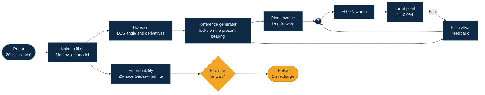
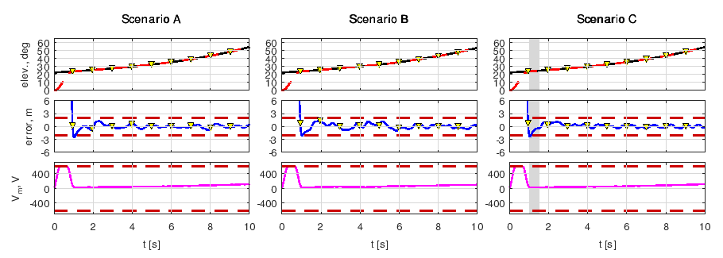

<p align="center">
  
</p>

<p align="center">
  <a href="https://github.com/Charon-68/Turrent-Control-System_ME319/actions/workflows/ci.yml"></a>
  <a href="#at-a-glance"></a>
  <a href="#verification"></a>
  <a href="https://octave.org/"></a>
  <a href="LICENSE"></a>
</p>

<p align="center">
  <a href="#at-a-glance"><b>Results</b></a>&nbsp;&nbsp;|&nbsp;&nbsp;<a href="#how-it-works"><b>How it works</b></a>&nbsp;&nbsp;|&nbsp;&nbsp;<a href="#run-it-in-a-minute"><b>Run it</b></a>&nbsp;&nbsp;|&nbsp;&nbsp;<a href="#repository-map"><b>Repository map</b></a>&nbsp;&nbsp;|&nbsp;&nbsp;<a href="#go-deeper"><b>Docs</b></a>
</p>

<br>

A turret has to hit a manoeuvring drone using nothing but noisy 20 Hz radar that can go silent for half a second, driven by a motor that rings if you push it too hard. This project solves that from first principles in **GNU Octave**: a Kalman filter that predicts the target, a controller that inverts the plant exactly, and a fire rule that pulls the trigger only when the posterior says the hit is in. Then it tests the frozen design on **1,000 engagements it has never seen**.

No MATLAB, no Simulink, no toolboxes. Every number below comes from a committed log you can regenerate.

> [!NOTE]
> This is an academic, software-only control-design project for ME 319 at IIT Bombay. The turret, target, radar and laser are all simulated; nothing here drives real hardware.

<br>

## At a glance

The frozen design, run on held-out seeds MC5000 to MC5999 at 100 Hz:

| | |
|:---|---:|
| Engagements intercepted | **1000 / 1000** |
| Failure probability, Wilson 95 % upper bound | **< 0.383 %** |
| First hit, mean / 95th percentile | **1.24 s / 1.82 s** |
| Pointing error RMS, median / 95th percentile | **0.56 m / 0.83 m** |
| Pulses on target | **9,198 of 9,204** (99.93 %) |
| Time inside the 2 m engagement radius | **99.43 %** |
| Controller cost per call | **0.53 ms** mean, 0.73 ms p99 |

<p align="center">
  
</p>

<details>
<summary><b>Standard scenarios A to D6</b> (100 Hz, turret starting at 0°)</summary>
<br>

| Scenario | What the target does | First hit | Pulses hit | Pointing RMS | In 2 m radius |
|:---|:---|---:|---:|---:|---:|
| **A** | Flies straight at constant velocity | 0.94 s | 9 / 9 | 0.40 m | 100 % |
| **B** | Smooth, bounded manoeuvres | 0.94 s | 9 / 9 | 0.51 m | 100 % |
| **C** | Scenario A with a 0.5 s radar blackout at 1 s | 0.94 s | 9 / 9 | 0.37 m | 100 % |
| **D1** | Breaks away during a data loss | 0.70 s | 10 / 10 | 0.43 m | 100 % |
| **D2** | Weaves | 0.98 s | 9 / 9 | 0.75 m | 100 % |
| **D3** | Close pass, turret reaches 83° | 1.23 s | 9 / 9 | 0.36 m | 100 % |
| **D4** | Repeated outages | 0.94 s | 9 / 9 | 0.73 m | 97.4 % |
| **D5** | Weaves from a close start | 1.12 s | 9 / 9 | 0.76 m | 98.1 % |
| **D6** | Aggressive jerk reversals | 1.07 s | 9 / 9 | 0.87 m | 96.0 % |

Source: [`outputs/suite_100Hz.txt`](outputs/suite_100Hz.txt), regenerated with `make scenarios`.

</details>

<details>
<summary><b>Call-rate check</b>: five separately written trajectory families, 100 cases each</summary>
<br>

| Controller rate | Intercepted | Mean first hit |
|---:|---:|---:|
| 20 Hz | 500 / 500 | 1.36 s |
| 100 Hz | 500 / 500 | 1.08 s |
| 1000 Hz | 500 / 500 | 1.08 s |

The families are weave, step, bang-bang, arc and pop-up, each with one random blackout and a random starting angle. The generator and runner were written separately from the main harness but by the same team, so this is implementation diversity, not external validation. Source: [`outputs/independent_check.txt`](outputs/independent_check.txt).

</details>

<br>

## The challenge

| Constraint | Value |
|:---|:---|
| Radar | 20 Hz range and bearing, σ<sub>r</sub> = 1 m, σ<sub>θ</sub> = 0.02° |
| Blackouts | Up to 0.5 s with no data at all |
| Target | Up to 150 m/s and 20 m/s², 800 to 2000 m away |
| Elevation drive | Lightly damped poles at 8.9 Hz, ζ = 0.094 |
| Limits | Travel from −10° to 85°, supply ±600 V (assumed) |
| Weapon | 2 m engagement radius, 1 s recharge, 0.5 s prediction horizon |

Following a measured angle is not enough. The controller has to estimate motion it cannot see, ride through blackouts, move a resonant turret without making it ring, and decide *when* a pulse is worth its one-second recharge.

<br>

## How it works



| Stage | What it does | Where |
|:---|:---|:---|
| **Estimate** | Converts each polar radar fix to bias-corrected Cartesian coordinates and runs a position–velocity–acceleration–jerk Kalman filter per axis, with innovation gating, Joseph-form updates and NIS-driven adaptive process noise. | [`core/tc_filter_update.m`](core/tc_filter_update.m) |
| **Nowcast** | Propagates the track to *now* and computes the line-of-sight angle and its derivatives analytically, so noisy bearings are never differentiated. | [`core/tc_los_derivatives.m`](core/tc_los_derivatives.m) |
| **Reference** | Builds a smooth reference that follows the present bearing through a stable triple pole, with acquisition clamps for large slews. | [`core/tc_reference_chain.m`](core/tc_reference_chain.m) |
| **Control** | Exact inverse of the nominal plant as feed-forward, plus PI feedback with high-frequency roll-off and conditional integration. | [`turret_controller.m`](turret_controller.m) |
| **Fire** | Integrates the posterior over acceleration hypotheses to get the probability that a pulse fired now lands within 2 m, then decides to fire, arm and wait, or hold. | [`core/tc_firing_rule.m`](core/tc_firing_rule.m) |

Every constant lives in one file, [`core/tc_params.m`](core/tc_params.m). Plant-derived quantities such as the feed-forward gains are computed there, never typed by hand.

> [!IMPORTANT]
> **Predict ahead, aim at the present.** The handout prescribes a 0.5 s prediction, but the laser is instantaneous: a pulse must cross the target where it is *now*. Aiming at the predicted bearing would miss by metres.
>
> So the prediction $`r = A_3(D)\,\hat\theta`$ is fed into a reference generator built to cancel it exactly:
>
> ```math
> (A_3 + K)(D)\,y_d = r + K(D)\,\hat\theta, \qquad A_3 + K = \tfrac{t_p^3}{6}(D+p)^3
> \quad\Longrightarrow\quad (D+p)^3\,(y_d - \hat\theta) = 0
> ```
>
> The reference converges on the current estimated bearing through a stable triple pole, and still supplies the three derivatives the plant inverse needs.

<details>
<summary><b>The math, stage by stage</b></summary>
<br>

**Target model.** Each Cartesian axis carries position, velocity, acceleration and a Gauss–Markov jerk:

```math
\mathbf{x} = [\,p,\ v,\ a,\ j\,]^\mathsf{T}, \qquad \dot j = -\frac{1}{\tau_j}\,j + w
```

Transition and process-noise matrices are closed-form for any sample gap, so a blackout needs no special case: one exact $`F(\Delta t), Q(\Delta t)`$ covers it.

**Third-order Taylor prediction** over the horizon $`t_p = 0.5`$ s:

```math
A_3(D) = 1 + t_p D + \frac{(t_p D)^2}{2} + \frac{(t_p D)^3}{6}
```

**Plant.** Armature and mechanics, with gear ratio $`N`$ reflecting the motor onto the turret shaft:

```math
L\,\dot i = V_m - R\,i - N K_e\,\dot\theta_T, \qquad J_{eq}\,\ddot\theta_T = N K_t\,i - b\,\dot\theta_T
```

```math
G_p(s) = \frac{\theta_T(s)}{V_m(s)} = \frac{1000}{s\,(320 s^2 + 3350 s + 1.0015\times 10^6)}, \qquad s = -5.23 \pm 55.70\,j
```

**Two-degree-of-freedom control.** Exact plant inverse plus PI with roll-off:

```math
V_m = G_p^{-1}(D)\,y_d + C(s)\,(y_d - \theta_T), \qquad C(s) = K_p\,\frac{T_i s + 1}{T_i s\,(\tau_f s + 1)}
```

```math
G_p^{-1}(D)\,y_d = 0.32\,\dddot y_d + 3.35\,\ddot y_d + 1001.5\,\dot y_d
```

**Fire control.** With acceleration $`a \sim \mathcal N(\mu_a, P_{aa})`$ truncated to the physical envelope, the position conditioned on $`a`$ is Gaussian, and the beam-normal offset $`d_i`$ of each of 25 tensor Gauss–Hermite nodes gives

```math
P_{hit} = \sum_i w_i \left[\Phi\!\left(\frac{R - d_i}{\sigma}\right) - \Phi\!\left(\frac{-R - d_i}{\sigma}\right)\right]
```

The rule fires immediately above 0.99, arms above 0.90 and fires at the probability peak or after 0.3 s, and during a blackout fires only while the probability is high and falling. After the first pulse the bar rises to 0.995.

</details>

### The loop, by the numbers

| $`K_p`$ | $`T_i`$ | $`\tau_f`$ | Crossover | Phase margin | Gain margin | Peak sensitivity | Bandwidth |
|---:|---:|---:|---:|---:|---:|---:|---:|
| 4000 V/rad | 1 s | 0.03 s | 4.10 rad/s | **68.5°** | **16.1 dB** | 1.21 | 5.72 rad/s |

All of it is derived with the project's own polynomial routines; no Control System Toolbox is needed.

<br>

## Figures

<table>
  <tr>
    <td width="50%"></td>
    <td width="50%"></td>
  </tr>
  <tr>
    <td align="center"><sub>Tracking, beam error, pulses and voltage for scenarios A to C</sub></td>
    <td align="center"><sub>Nowcast and prediction error, including the blackout</sub></td>
  </tr>
  <tr>
    <td width="50%"></td>
    <td width="50%"></td>
  </tr>
  <tr>
    <td align="center"><sub>Pole-zero map, Bode response and step response</sub></td>
    <td align="center"><sub>Closed-loop architecture, drawn from the model</sub></td>
  </tr>
</table>

Eleven more course-concept studies (root locus, Routh limits, sensitivity, sampling and delay, ±20 % parameter uncertainty, compensator comparison) live in [`plots/`](plots/) and [`outputs/`](outputs/).

<br>

## Run it in a minute

You need GNU Octave and Make (`brew install octave` or `sudo apt-get install octave make`).

```bash
git clone https://github.com/Charon-68/Turrent-Control-System_ME319.git
cd Turrent-Control-System_ME319
make quick
```

That runs the fast checks, all nine scenarios and the loop design report. Expect a table like this:

```text
scn  first hit    hits   RMS [m]  in R_eng   V_peak
A        0.94s   9/9        0.40    100.0%      589
B        0.94s   9/9        0.51    100.0%      589
C        0.94s   9/9        0.37    100.0%      589
...
```

<details>
<summary><b>Every <code>make</code> target</b></summary>
<br>

| Command | What it does |
|:---|:---|
| `make quick` | Fast checks, scenario suite and design report |
| `make test-quick` | Quick verification subset (what CI runs) |
| `make test` | Full 25-check verification suite |
| `make scenarios` | Scenarios A to D6 at 100 Hz |
| `make design` | Plant and loop design metrics |
| `make eval-check` | Evaluation-interface adapter and MATLAB-syntax scan |
| `make figures` | Design, error-budget and scenario plots |
| `make report-figures` | The six figures used in the report |
| `make heldout` | Held-out chunk MC5000 to 5299 |
| `make heldout-merge` | Merge the three held-out chunks into `outputs/heldout_final` |
| `make independent` | Independent campaign: five families, then its report |
| `make ablation` | Paired ablation study on MC201 to 260 |
| `make robustness` | Call rate, conventions, start angle, mismatch and sensor stress |
| `make calibration` | Hit-probability calibration study |
| `make timing` | Cost of one controller call |
| `make start-angle` | First-pulse miss versus starting angle |
| `make course` | All eleven course-concept studies (or one: `course-bode`, `course-sens`, ...) |
| `make export` | Regenerate the report's numbers and tables |
| `make report-zip` | Build the Overleaf bundle `build/overleaf.zip` |

`make heldout` runs one chunk. The committed 1,000-seed result merges three chunks; [`outputs/README.md`](outputs/README.md) records the exact commands.

</details>

### Drop the controller into your own loop

The three assignment functions sit in the repository root. This runs 5 s of scenario B with a 100 Hz controller and a 1 kHz plant:

```octave
tc_setup();  clear turret_controller
dt = 1e-3;  x = [0; 0; 0];            % plant state [theta; theta_dot; i]
V = 0;  fired = [];  last = 0;
for k = 0:5000
  t = k*dt;
  if mod(k, 10) == 0                  % controller at 100 Hz
    [r, th, ok] = target_motion_generator(t, 'B');
    [V, fire] = turret_controller(t, r, th, ok, x(1), x(2));
    if fire && ~last, fired(end+1) = t; end
    last = fire;
  end
  [d1, d2, d3] = turret_plant(t, V, x(1), x(2), x(3));
  x = x + dt*[d1; d2; d3];            % forward Euler is stable for dt <= 1 ms
end
fprintf('pulses at: %s s\n', mat2str(fired, 3));   % pulses at: [0.94 1.95 2.96 3.97 4.98] s
```

The controller keeps state between calls: start at $`t = 0`$, keep time increasing, and `clear turret_controller` between runs. Ask for a third output, `[V, fire, dbg] = turret_controller(...)`, to see the mode, estimate, feed-forward and feedback split, and hit probability at every tick.

<br>

## Repository map

```text
├── turret_controller.m          the controller and fire logic (assignment interface)
├── turret_plant.m               elevation-drive dynamics (assignment interface)
├── target_motion_generator.m    scripted and seeded targets with radar noise (assignment interface)
├── tc_setup.m                   puts the project folders on the path
├── Makefile                     every reproducible command
│
├── core/          estimator, prediction, reference, fire control, and tc_params.m
├── simulation/    closed-loop runner, campaigns, independent generator
├── studies/       analyses, ablations, robustness, plotting, report export
├── tests/         25-check suite, evaluation-interface adapter, syntax scan
├── docs/          design notes, assumptions, protocol, decisions, handout
├── outputs/       every result log and saved dataset, with provenance
├── plots/         every figure, as PNG and PDF
└── report/        IEEE-format report; generated/ holds its numbers and tables
```

<br>

## Verification

[`tests/tc_test_all.m`](tests/tc_test_all.m) is a self-contained suite with no xUnit dependency. CI runs the quick subset, the scenario table and the evaluation-interface checks on every push.

<details>
<summary><b>What the 25 checks cover</b></summary>
<br>

- Plant poles, linearisation and voltage saturation
- Feed-forward coefficients re-derived from the plant
- Kalman transition matrices against a Van Loan construction
- Polar-to-Cartesian conversion and its covariance
- Line-of-sight derivatives
- Stability of the Taylor reference and beam-miss geometry
- Scenario envelopes, radar ticks, blackouts and deterministic noise
- Hit-probability monotonicity and fire-control geometry
- Exact zero-order-hold and RK4 integration agree
- Continuous-loop gain and phase margins
- Interception at the standard rates and measurement conventions
- Lost-track recovery, repeatability and plant mismatch

```text
PASS  t_plant_poles
PASS  t_plant_saturation
...
PASS  t_plant_mismatch
25/25 checks passed
```

Full log: [`outputs/test_full.txt`](outputs/test_full.txt).

</details>

<br>

## Honest numbers

The protocol keeps tuning and evaluation apart, so every headline number is one the design never trained on.

| Seeds | Used for |
|:---|:---|
| MC1 to MC200 | Tuning and calibration |
| MC201 to MC4999 | Exploration and paired design studies |
| MC5000 to MC5999 | **Held-out evaluation only**, run once on the frozen design |
| HB&lt;seed&gt; | Adversarial stress tests, reported separately |

A run with no hit counts as a failure; it is never dropped from the statistics.

> [!WARNING]
> **Know the limits.** 1,000 out of 1,000 is an empirical result for this simulator and seed family, not a guarantee for arbitrary targets or real hardware.
> - The plant inverse assumes the nominal model. ±20 % parameter mismatch is tested, and opposite-sign $`K_t`$/$`K_e`$ errors are the worst documented case.
> - The ±600 V supply and 10 A acquisition budget are assumptions; the handout leaves them open.
> - Coulomb friction and voltage dead-zone are explored as variants; the nominal plant uses viscous damping only.
> - From an 80° start the first pulse misses by 2.11 m and the first hit slips by one recharge. [`docs/START_ANGLE_FINDING.md`](docs/START_ANGLE_FINDING.md) explains why.

<br>

## Go deeper

| Read | For |
|:---|:---|
| [`docs/DESIGN.md`](docs/DESIGN.md) | Architecture and the reasoning behind each block |
| [`docs/ANALYSIS.md`](docs/ANALYSIS.md) | Plant, Routh, root locus, Bode and transient analysis |
| [`docs/DECISIONS.md`](docs/DECISIONS.md) | Every design decision and the measurement that settled it |
| [`docs/DESIGN_ITERATIONS.md`](docs/DESIGN_ITERATIONS.md) | Alternatives that were tried, adopted or rejected |
| [`docs/ASSUMPTIONS.md`](docs/ASSUMPTIONS.md) | What the handout leaves open, and what changes if we guessed wrong |
| [`docs/PROTOCOL.md`](docs/PROTOCOL.md) | Seed separation and statistical reporting rules |
| [`outputs/README.md`](outputs/README.md) | The exact command behind every result file |
| [`report/`](report/README.md) | The IEEE-format report: `make export` refreshes its numbers, `make report-zip` bundles it for Overleaf |

<br>

## Team

Shourya Saxena, Shashwat Gupta, Surhud Naik and Jay Motwani, for ME 319 Control Systems at IIT Bombay, Autumn 2026.

Released under the [MIT License](LICENSE).

<br>

<p align="center">
  <i>Estimate the motion. Track the present. Fire on probability.</i>
</p>
